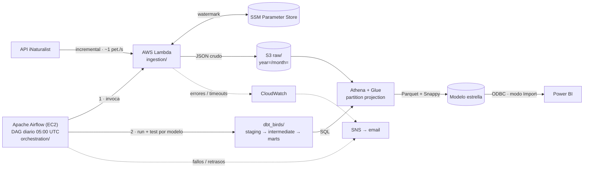

# Oiseaux Nantes — Pipeline Analítico de Biodiversidad

[English](README.md) · **Español** · [Français](README.fr.md)

Pipeline ELT de extremo a extremo en AWS que ingesta de forma incremental **observaciones de
aves en el Gran Nantes (Francia)** desde la plataforma de ciencia ciudadana
[iNaturalist](https://www.inaturalist.org), guarda el JSON crudo en un **data lake en S3**, lo
transforma con **dbt sobre Athena** en una arquitectura medallón (raw → staging → marts) hasta
un **modelo estrella en Parquet** y lo sirve a **Power BI**. **Apache Airflow** orquesta cada día
la ingesta y la transformación.

Es un proyecto de referencia del modern data stack: EL serverless, analytics engineering con
dbt, tests automáticos de calidad de datos, infraestructura como código y seguridad de mínimo
privilegio, con un coste operativo casi nulo.


*Informe de Power BI sobre el modelo estrella (año 2026, todas las estaciones y grados de calidad).*

## En cifras

| | |
|---|---|
| **En producción desde** | 2026-10-12 · ejecución diaria a las 05:00 UTC |
| **Datos** | 18.454 observaciones · 583 taxones · 1.874 observadores (de 1970 a hoy) |
| **Calidad** | 77 tests de dbt; un test fallido detiene todos los modelos que dependen de él |
| **Orquestación** | DAG de Airflow con 13 tareas (una pareja `run` + `test` por modelo dbt) |
| **Coste** | ~20 USD/mes (EC2 de Airflow); Lambda, S3 y Athena cuestan céntimos |

## ¿Qué responde?

- ¿Qué especies de aves se observan más en Nantes?
- ¿Cuándo alcanzan su pico las observaciones a lo largo del año (estacionalidad biológica)?
- ¿Dónde se concentran los avistamientos y quiénes son los observadores más activos?
- ¿Qué proporción de observaciones tiene grado de investigación (identificación confirmada por la comunidad)?

## Arquitectura



La cartografía completa (flujo de ingesta, DAG de Airflow, linaje de dbt, modelo dimensional y
CI) está en [docs/architecture.md](docs/architecture.md).


*DAG `nantes_birds_pipeline` en Airflow 3: diario a las 05:00 UTC, ingesta y después los modelos dbt.*

### Principios de diseño

| Principio | En la práctica |
|-----------|----------------|
| Separación ELT | Airflow solo orquesta; Lambda solo extrae y carga; dbt transforma; Power BI lee solo `marts` |
| Uso ético de la API | Ingesta incremental con watermark, ~1 petición/s, cabecera `User-Agent` identificable |
| Calidad sin fallos | Tests de unicidad, área geográfica y `quality_grade`; un test fallido bloquea los modelos posteriores |
| Mínimo privilegio y coste | IAM sin ARNs comodín (dos excepciones documentadas), EC2 privada accesible por Session Manager, Parquet + Snappy |
| Idempotencia | Deduplicación por `observation_id`; el watermark solo avanza tras escribir en S3 |

Las reglas del proyecto están en la [constitución](.specify/memory/constitution.md).

## Stack tecnológico

| Capa | Tecnología |
|------|------------|
| Ingesta | AWS Lambda (Python, `requests`, `boto3`) |
| Estado incremental | AWS SSM Parameter Store |
| Data lake | AWS S3 (JSON crudo, marts en Parquet) |
| Catálogo y cómputo | AWS Glue Data Catalog + Amazon Athena (partition projection) |
| Transformación | dbt-core + dbt-athena, `dbt_utils` |
| Orquestación | Apache Airflow 3.3 + Astronomer Cosmos en EC2 (t3.small, LocalExecutor, PostgreSQL) |
| Infraestructura como código | Terraform |
| Alertas | Callbacks de Airflow + alarmas de CloudWatch → email por SNS |
| CI | GitHub Actions |
| BI | Power BI Desktop (Amazon Athena ODBC 2.x) |

## Modelo de datos

| Capa | Modelo | Materialización | Función |
|------|--------|-----------------|---------|
| Raw | `birds_raw.observations` | tabla externa | JSON de iNaturalist tal como llega, particionado por año/mes de ingesta |
| Staging | `stg_inaturalist__observations` | view | Tipos, aplanado del JSON, deduplicación |
| Intermedia | `int_observations__geospatial_enriched` | view | Filtro del área, franja horaria, bandera de grado de investigación |
| Marts | `fct_observations` | table, reconstruida a diario y particionada por año/mes | Una fila por observación |
| Marts | `dim_species` | table | Taxón, con foto, licencia, crédito y enlace a Wikipedia |
| Marts | `dim_users` | table | Observador |
| Marts | `dim_date` | table | Calendario con estación biológica |

Decisiones de calidad de datos tomadas durante el despliegue: las observaciones sin fecha de
observación se conservan en staging (test de aviso) y se excluyen del modelo estrella; las
dimensiones guardan los atributos más recientes de cada clave; la tabla de hechos se reconstruye
cada día para no perder las subidas tardías. Columnas y tests:
[data-model.md](specs/001-nantes-birds-pipeline/data-model.md).

## Estructura del repositorio

```text
.
├── ingestion/            # Lambda: cliente de iNaturalist, escritura en S3, watermark en SSM
├── dbt_birds/            # Proyecto dbt: macro de la tabla raw, staging, intermedia, marts, tests
├── orchestration/        # Airflow: DAG, alertas, configuración, bootstrap, despliegue, systemd
├── infra/airflow/        # Terraform: EC2, rol IAM, security group
├── tests/                # pytest: ingesta (unitarios, integración) e integridad del DAG
├── .github/workflows/    # CI: dbt parse e integridad del DAG en cada PR
├── docs/                 # Arquitectura, despliegue en AWS, operación de Airflow, Power BI, validación
└── specs/                # Spec, plan, investigación, contratos y tareas de cada feature (Spec Kit)
```

## Puesta en marcha

Despliegue paso a paso desde cero (cuenta de AWS, Lambda, carga inicial, Terraform, Airflow,
paso a producción): [docs/despliegue-aws.md](docs/despliegue-aws.md).

Comprobaciones en local, sin AWS:

```bash
# Tests unitarios de la ingesta
pip install -r ingestion/requirements.txt -r tests/requirements-dev.txt
PYTHONPATH=ingestion pytest tests/unit/ -v

# Integridad del DAG de Airflow (Python 3.12; dbt en su propio entorno virtual)
pip install -r orchestration/requirements.txt \
  --constraint https://raw.githubusercontent.com/apache/airflow/constraints-3.3.2/constraints-3.12.txt
cd dbt_birds && dbt deps && BIRDS_S3_BUCKET=ci-placeholder \
  dbt parse --profiles-dir ../orchestration/config --target ci && cd ..
pytest tests/orchestration/ -v
```

Conexión de Power BI (usuario IAM de solo lectura, driver ODBC, modelo estrella, visuales y DAX):
[docs/powerbi-setup.md](docs/powerbi-setup.md).

## Estado del proyecto

| Componente | Estado |
|------------|--------|
| Ingesta en Lambda + 14 tests unitarios | ✅ En producción |
| Modelos dbt + 77 tests de datos | ✅ En producción |
| Orquestación con Airflow (Terraform, EC2, DAG, alertas) | ✅ Ejecuciones diarias programadas en verde desde el 2026-10-13 |
| CI (GitHub Actions) | ✅ dbt parse + 26 tests del DAG · ⏳ `dbt test` contra Athena (requiere credenciales OIDC) |
| Informe de Power BI | ✅ Modelo estrella, mapa, estacionalidad, rankings y Top 3 con fotos de especies · ⏳ `.pbix` aún no está en el repositorio |
| Validación pendiente | ⏳ Simulacros de fallos y alertas, reconstrucción completa, simulación IAM, revisión del coste mensual |

Resultados del despliegue y problemas corregidos por el camino:
[docs/validation-results.md](docs/validation-results.md).

## Próximos pasos

- Analizar la franja horaria con la hora real de observación (`time_observed_at`) en lugar de la hora de subida
- Refrescar las observaciones cuyo grado de calidad cambia después de la descarga
- Historial SCD Tipo 2 en `dim_species` con snapshots de dbt
- `dbt test` contra Athena en la CI (rol OIDC de GitHub) y despliegue automático en el servidor de Airflow al fusionar
- Esquemas separados para staging y marts; nombres comunes en francés (`locale=fr`)

## Documentación

- Feature 001, pipeline: [spec](specs/001-nantes-birds-pipeline/spec.md) · [plan](specs/001-nantes-birds-pipeline/plan.md) · [modelo de datos](specs/001-nantes-birds-pipeline/data-model.md) · [tareas](specs/001-nantes-birds-pipeline/tasks.md)
- Feature 002, orquestación con Airflow: [spec](specs/002-airflow-orchestration/spec.md) · [plan](specs/002-airflow-orchestration/plan.md) · [tareas](specs/002-airflow-orchestration/tasks.md)
- [Instructivo de despliegue en AWS](docs/despliegue-aws.md) · [Operación de Airflow](docs/airflow-operations.md) · [Infraestructura](docs/infrastructure.md) · [Power BI](docs/powerbi-setup.md)

## Datos y licencias

Los datos proceden de la API pública de iNaturalist; cada observación y cada foto de especie
conserva la licencia elegida por su autor. El crédito de la foto se guarda con cada especie y
debe mostrarse junto a la imagen. El pipeline respeta los límites de uso de la API y se
identifica con la cabecera `User-Agent`.
