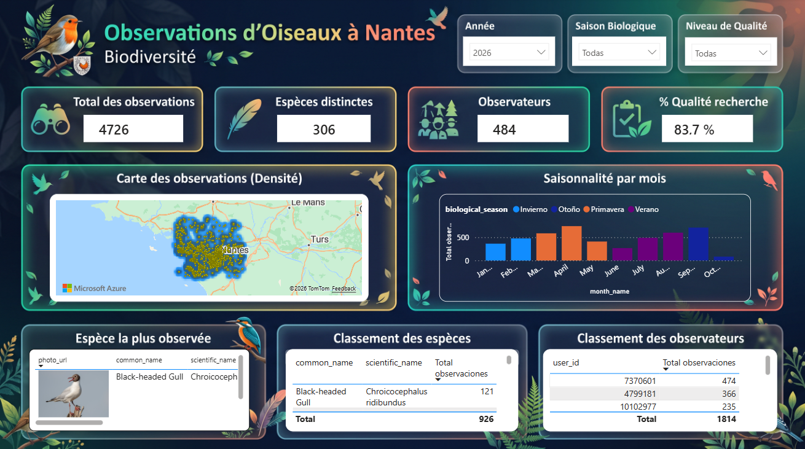
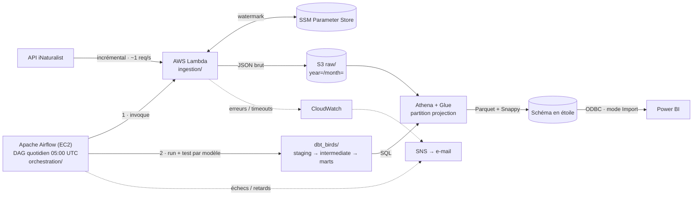
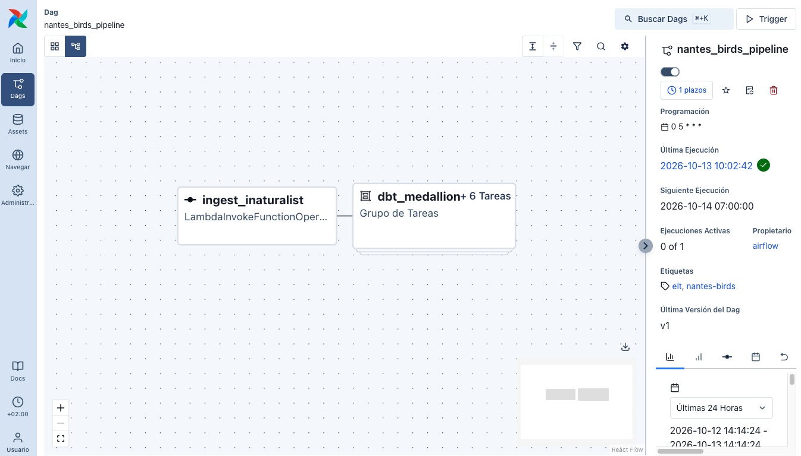

# Oiseaux Nantes — Pipeline analytique de biodiversité

[English](README.md) · [Español](README.es.md) · **Français**

Pipeline ELT de bout en bout sur AWS qui ingère de façon incrémentale les **observations
d'oiseaux dans l'agglomération nantaise** depuis la plateforme de science participative
[iNaturalist](https://www.inaturalist.org), stocke le JSON brut dans un **data lake S3**, le
transforme avec **dbt sur Athena** selon une architecture médaillon (raw → staging → marts)
jusqu'à un **schéma en étoile au format Parquet**, et l'expose dans **Power BI**.
**Apache Airflow** orchestre chaque jour l'ingestion et la transformation.

C'est un projet de référence du modern data stack : EL serverless, analytics engineering avec
dbt, tests automatisés de qualité des données, infrastructure as code et sécurité au moindre
privilège, pour un coût d'exploitation quasi nul.

> **État :** déployé et validé en production sur AWS du 12 au 16/10/2026, puis infrastructure
> retirée pour éviter tout coût. Tout le nécessaire pour le redéployer se trouve dans ce dépôt :
> [docs/despliegue-aws.md](docs/despliegue-aws.md) (en espagnol).



*Rapport Power BI sur le schéma en étoile (année 2026, toutes saisons et tous niveaux de qualité).*

## En chiffres

| | |
|---|---|
| **En production** | Du 12/10/2026 au 16/10/2026 · exécution quotidienne à 05:00 UTC · infrastructure retirée |
| **Données** | 18 454 observations · 583 taxons · 1 874 observateurs (de 1970 à aujourd'hui) |
| **Qualité** | 77 tests dbt ; un test en échec bloque tous les modèles qui en dépendent |
| **Orchestration** | DAG Airflow de 13 tâches (une paire `run` + `test` par modèle dbt) |
| **Coût** | ~20 USD/mois pendant le déploiement (EC2 d'Airflow) ; Lambda, S3 et Athena coûtent quelques centimes |

## À quelles questions répond-il ?

- Quelles espèces d'oiseaux sont les plus observées autour de Nantes ?
- À quel moment de l'année les observations culminent-elles (saisonnalité biologique) ?
- Où se concentrent les observations, et qui sont les observateurs les plus actifs ?
- Quelle part des observations est de *qualité recherche* (identification confirmée par la communauté) ?

## Architecture



La cartographie complète du système (flux d'ingestion, DAG Airflow, lignage dbt, modèle
dimensionnel, CI) se trouve dans [docs/architecture.md](docs/architecture.md).



*DAG `nantes_birds_pipeline` dans Airflow 3 : chaque jour à 05:00 UTC, ingestion puis modèles dbt.*

### Principes de conception

| Principe | En pratique |
|----------|-------------|
| Séparation ELT | Airflow orchestre seulement ; Lambda extrait et charge ; dbt transforme ; Power BI ne lit que `marts` |
| Usage éthique de l'API | Ingestion incrémentale avec watermark, ~1 requête/s, en-tête `User-Agent` identifiable |
| Qualité zéro défaut | Tests d'unicité, de zone géographique et de `quality_grade` ; un test en échec bloque la suite |
| Moindre privilège et coûts | Aucun ARN IAM générique (deux exceptions documentées), EC2 privée accessible via Session Manager, Parquet + Snappy |
| Idempotence | Déduplication sur `observation_id` ; le watermark n'avance qu'après une écriture réussie dans S3 |

Les règles du projet sont dans la [constitution](.specify/memory/constitution.md).

## Stack technique

| Couche | Technologie |
|--------|-------------|
| Ingestion | AWS Lambda (Python, `requests`, `boto3`) |
| État incrémental | AWS SSM Parameter Store |
| Data lake | AWS S3 (JSON brut, marts en Parquet) |
| Catalogue et calcul | AWS Glue Data Catalog + Amazon Athena (partition projection) |
| Transformation | dbt-core + dbt-athena, `dbt_utils` |
| Orchestration | Apache Airflow 3.3 + Astronomer Cosmos sur EC2 (t3.small, LocalExecutor, PostgreSQL) |
| Infrastructure as code | Terraform |
| Alertes | Callbacks Airflow + alarmes CloudWatch → e-mail via SNS |
| CI | GitHub Actions |
| BI | Power BI Desktop (Amazon Athena ODBC 2.x) |

## Modèle de données

| Couche | Modèle | Matérialisation | Rôle |
|--------|--------|-----------------|------|
| Raw | `birds_raw.observations` | table externe | JSON iNaturalist tel quel, partitionné par année/mois d'ingestion |
| Staging | `stg_inaturalist__observations` | view | Typage, aplatissement du JSON, déduplication |
| Intermédiaire | `int_observations__geospatial_enriched` | view | Filtre géographique, tranche horaire, indicateur qualité recherche |
| Marts | `fct_observations` | table reconstruite chaque jour, partitionnée par année/mois | Une ligne par observation |
| Marts | `dim_species` | table | Taxon, avec photo, licence, crédit et lien Wikipédia |
| Marts | `dim_users` | table | Observateur |
| Marts | `dim_date` | table | Calendrier avec saison biologique |

Décisions de qualité des données prises lors du déploiement : les observations sans date
d'observation sont conservées en staging (test d'avertissement) et exclues du schéma en étoile ;
les dimensions gardent les attributs les plus récents de chaque clé ; la table de faits est
reconstruite chaque jour pour ne jamais manquer les envois tardifs. Colonnes et tests :
[data-model.md](specs/001-nantes-birds-pipeline/data-model.md).

## Organisation du dépôt

```text
.
├── ingestion/            # Lambda : client iNaturalist, écriture S3, watermark SSM
├── dbt_birds/            # Projet dbt : macro de la table raw, staging, intermédiaire, marts, tests
├── orchestration/        # Airflow : DAG, alertes, configuration, bootstrap, déploiement, systemd
├── infra/airflow/        # Terraform : EC2, rôle IAM, security group
├── tests/                # pytest : ingestion (unitaires, intégration) et intégrité du DAG
├── .github/workflows/    # CI : dbt parse et intégrité du DAG à chaque PR
├── docs/                 # Architecture, déploiement AWS, exploitation d'Airflow, Power BI, validation
└── specs/                # Spec, plan, recherche, contrats et tâches par fonctionnalité (Spec Kit)
```

## Démarrage

Déploiement pas à pas depuis zéro (compte AWS, Lambda, chargement initial, Terraform, Airflow,
mise en production) : [docs/despliegue-aws.md](docs/despliegue-aws.md) (en espagnol).

Vérifications en local, sans AWS :

```bash
# Tests unitaires de l'ingestion
pip install -r ingestion/requirements.txt -r tests/requirements-dev.txt
PYTHONPATH=ingestion pytest tests/unit/ -v

# Intégrité du DAG Airflow (Python 3.12 ; dbt dans son propre environnement virtuel)
pip install -r orchestration/requirements.txt \
  --constraint https://raw.githubusercontent.com/apache/airflow/constraints-3.3.2/constraints-3.12.txt
cd dbt_birds && dbt deps && BIRDS_S3_BUCKET=ci-placeholder \
  dbt parse --profiles-dir ../orchestration/config --target ci && cd ..
pytest tests/orchestration/ -v
```

Connexion Power BI (utilisateur IAM en lecture seule, pilote ODBC, schéma en étoile, visuels et
DAX) : [docs/powerbi-setup.md](docs/powerbi-setup.md).

## État du projet

| Composant | État |
|-----------|------|
| Ingestion Lambda + 14 tests unitaires | ✅ Validée en production |
| Modèles dbt + 77 tests de données | ✅ Validés en production |
| Orchestration Airflow (Terraform, EC2, DAG, alertes) | ✅ Exécutions quotidiennes programmées réussies du 13/10/2026 au 16/10/2026 |
| CI (GitHub Actions) | ✅ dbt parse + 26 tests du DAG · ⏳ `dbt test` sur Athena (identifiants OIDC à configurer) |
| Rapport Power BI | ✅ Schéma en étoile, carte, saisonnalité, classements, top 3 avec photos d'espèces · ⏳ `.pbix` pas encore dans le dépôt |
| Validation restante | ⏸ Lors d'un redéploiement : exercices contrôlés de panne et d'alerte, reconstruction complète, simulation IAM, revue du coût mensuel |
| Infrastructure AWS | 🗑 Retirée le 16/10/2026 (`terraform destroy` + nettoyage manuel) ; coût actuel 0 USD |

Résultats du déploiement et problèmes corrigés en cours de route :
[docs/validation-results.md](docs/validation-results.md).

## Feuille de route

- Analyser la tranche horaire à partir de l'heure réelle d'observation (`time_observed_at`) plutôt que de l'heure d'envoi
- Rafraîchir les observations dont le niveau de qualité change après le téléchargement
- Historique SCD de type 2 pour `dim_species` avec les snapshots dbt
- `dbt test` sur Athena dans la CI (rôle OIDC GitHub) et déploiement automatique sur le serveur Airflow à chaque merge
- Schémas séparés pour staging et marts ; noms communs en français (`locale=fr`)

## Documentation

La documentation détaillée est rédigée en espagnol.

- Fonctionnalité 001, pipeline : [spec](specs/001-nantes-birds-pipeline/spec.md) · [plan](specs/001-nantes-birds-pipeline/plan.md) · [modèle de données](specs/001-nantes-birds-pipeline/data-model.md) · [tâches](specs/001-nantes-birds-pipeline/tasks.md)
- Fonctionnalité 002, orchestration Airflow : [spec](specs/002-airflow-orchestration/spec.md) · [plan](specs/002-airflow-orchestration/plan.md) · [tâches](specs/002-airflow-orchestration/tasks.md)
- [Guide de déploiement AWS](docs/despliegue-aws.md) · [Exploitation d'Airflow](docs/airflow-operations.md) · [Infrastructure](docs/infrastructure.md) · [Power BI](docs/powerbi-setup.md)

## Données et licences

Les données proviennent de l'API publique d'iNaturalist ; chaque observation et chaque photo
d'espèce conserve la licence choisie par son auteur. Le crédit photo est stocké avec chaque
espèce et doit être affiché à côté de l'image. Le pipeline respecte les limites d'usage de
l'API et s'identifie avec un en-tête `User-Agent`.
