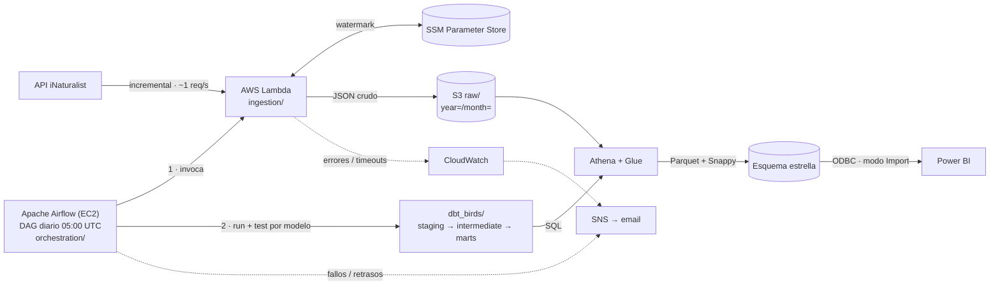

# Oiseaux Nantes — Pipeline Analítico de Biodiversidad

Pipeline de datos end-to-end que ingesta observaciones de **aves (Aves) en el Gran Nantes**
desde la plataforma de ciencia ciudadana [iNaturalist](https://www.inaturalist.org), las
almacena en un Data Lake en **AWS S3**, las transforma con **dbt Core sobre AWS Athena**
mediante una arquitectura medallón (staging → intermedia → marts) y sirve un modelo dimensional
en esquema estrella a **Power BI**. **Apache Airflow** orquesta cada día la ingesta y la
transformación.

Es un proyecto de referencia de Data Engineering moderno: EL serverless, analytics engineering
con dbt, calidad de datos con tests automatizados y coste operativo cercano a cero.

## ¿Qué responde?

- ¿Qué especies de aves se observan más en Nantes?
- ¿Cuándo alcanzan su pico las observaciones a lo largo del año (estacionalidad biológica)?
- ¿Dónde se concentran los avistamientos y quiénes son los observadores más activos?
- ¿Qué proporción de observaciones tiene grado de investigación (*research grade*)?

## Arquitectura



La cartografía completa (flujo de ingesta, DAG de Airflow, linaje de dbt, modelo dimensional y
CI) está en
[docs/architecture.md](docs/architecture.md).

### Principios de diseño

| Principio | En la práctica |
|-----------|----------------|
| Separación ELT | Airflow solo orquesta; Lambda solo extrae y carga; dbt transforma; Power BI lee solo `marts` |
| API ética | Ingesta incremental, ~1 petición/s, cabecera `User-Agent` identificable |
| Calidad sin fallos | Tests dbt de unicidad, bounding box y `quality_grade`; un fallo bloquea el merge |
| Mínimo privilegio y coste | IAM sin comodines, Lambda ≤ 3 min, Parquet + Snappy, partition pruning |
| Idempotencia | Deduplicación por `observation_id`; el watermark solo avanza tras una escritura exitosa |

Detalle completo en la [constitución del proyecto](.specify/memory/constitution.md).

## Stack Tecnológico

| Capa | Tecnología |
|------|------------|
| Ingesta | AWS Lambda (Python 3.11+, `requests`, `boto3`) |
| Orquestación | Apache Airflow 3.3 + Astronomer Cosmos en EC2 (t3.small); EventBridge desactivado |
| Infraestructura como código | Terraform (`infra/airflow/`) |
| Estado incremental | AWS SSM Parameter Store |
| Data Lake | AWS S3 (raw JSON / procesado Parquet) |
| Catálogo y cómputo | AWS Glue Data Catalog + AWS Athena |
| Transformación | dbt-core + dbt-athena, `dbt_utils` |
| Visualización | Power BI Desktop / Service |
| CI | GitHub Actions |
| Alertas | Callbacks de Airflow + CloudWatch Alarms → SNS |

## Modelo de Datos

| Capa | Modelo | Materialización | Función |
|------|--------|-----------------|---------|
| Staging | `stg_inaturalist__observations` | view | Casteo, aplanado del JSON, deduplicación |
| Intermedia | `int_observations__geospatial_enriched` | view | Filtro bbox, franja horaria, bandera *research grade* |
| Marts | `fct_observations` | table, reconstruida a diario (particionada por año/mes) | Hechos: una fila por observación |
| Marts | `dim_species` | table | Especie / taxón |
| Marts | `dim_users` | table | Observador |
| Marts | `dim_date` | table | Calendario con estación biológica |

Columnas, tests y contratos en [data-model.md](specs/001-nantes-birds-pipeline/data-model.md)
y [contracts/dbt-models.md](specs/001-nantes-birds-pipeline/contracts/dbt-models.md).

## Estructura del Repositorio

```text
.
├── ingestion/                 # Lambda: cliente iNaturalist, escritor S3, watermark SSM
├── tests/                     # pytest + moto (unit) y test contra la API real (integration)
├── dbt_birds/                 # Proyecto dbt: sources, staging, intermediate, marts, tests
├── orchestration/             # Airflow: DAG, alertas, configuración, bootstrap, despliegue, systemd
├── infra/airflow/             # Terraform de la EC2 de Airflow (IAM, security group)
├── .github/workflows/         # CI: dbt parse e integridad del DAG en cada PR
├── reports/                   # Informe de Power BI (.pbix)
├── docs/                      # Arquitectura, infraestructura, Airflow, Power BI, validación
└── specs/                     # Spec, plan, investigación, contratos y tareas de cada feature
    ├── 001-nantes-birds-pipeline/
    └── 002-airflow-orchestration/
```

## Puesta en Marcha

> Para un despliegue completo desde cero en AWS, seguir el
> [instructivo de despliegue](docs/despliegue-aws.md) paso a paso.

### Requisitos

- Python 3.11+ (ingesta) y Python 3.12 (Airflow)
- Terraform ≥ 1.6 y el Session Manager plugin de AWS CLI (orquestación)
- Cuenta de AWS en `eu-west-3` con un bucket S3, las bases de datos de Glue `birds_raw` y
  `birds_dbt` y un workgroup de Athena
- Power BI Desktop con el driver ODBC de Amazon Athena (solo para el informe)

### Tests de la ingesta (sin AWS)

```bash
pip install -r ingestion/requirements.txt -r tests/requirements-dev.txt
PYTHONPATH=ingestion pytest tests/unit/ -v

# Test de integración contra la API real de iNaturalist (solo lectura)
PYTHONPATH=ingestion pytest tests/integration/ -m integration -v
```

### Despliegue de la ingesta

1. Empaquetar `ingestion/` y desplegarlo como la Lambda `birds-inaturalist-ingestion` con la
   variable de entorno `BIRDS_S3_BUCKET`.
2. Configurar el rol IAM, el topic SNS y las alarmas siguiendo
   [docs/infrastructure.md](docs/infrastructure.md). La regla de EventBridge solo se usa para
   revertir: la programación diaria la hace Airflow.

### Orquestación con Airflow

```bash
cd infra/airflow
terraform init
terraform apply -var bucket_name=<bucket>   # EC2 + IAM + security group; instala Airflow
```

Acceso a la UI (por Session Manager, sin puertos abiertos), despliegue de cambios, ejecuciones
manuales y reconstrucción completa (`full_refresh`) en
[docs/airflow-operations.md](docs/airflow-operations.md). Tests del DAG:

```bash
# dbt en un virtualenv aparte; BIRDS_S3_BUCKET es obligatoria para dbt parse
cd dbt_birds && dbt deps && BIRDS_S3_BUCKET=ci-placeholder \
  dbt parse --profiles-dir ../orchestration/config --target ci && cd ..
pytest tests/orchestration/ -v
```

### Transformaciones dbt

```bash
pip install dbt-athena-community
cd dbt_birds
dbt deps
BIRDS_S3_BUCKET=<bucket> dbt run-operation create_raw_observations_table   # tabla raw (idempotente)
dbt run --full-refresh                     # primera ejecución
dbt test
```

Configurar `s3_staging_dir` y `s3_data_dir` en [dbt_birds/profiles.yml](dbt_birds/profiles.yml).

### Power BI

Seguir [docs/powerbi-setup.md](docs/powerbi-setup.md): conexión ODBC, relaciones del esquema
estrella, los tres visuales (mapa, tendencia estacional, ranking) y las medidas DAX.

## Estado del Proyecto

| Componente | Estado |
|------------|--------|
| Ingesta en Lambda + tests unitarios | ✅ Implementada — 14/14 tests pasan |
| Modelos y tests dbt | ✅ Implementados |
| CI de GitHub Actions | ✅ `dbt parse` + integridad del DAG · ⏳ `dbt test` contra Athena pendiente de credenciales (OIDC) |
| Orquestación con Airflow (código, Terraform, docs) | ✅ Implementada — pendiente de desplegar y validar en AWS |
| Documentación de infraestructura y Power BI | ✅ Completa |
| Informe `reports/nantes_birds.pbix` | ⏳ Pendiente (se crea en Power BI Desktop) |
| Validación end-to-end en AWS real | ⏳ Pendiente — ver [validation-results.md](docs/validation-results.md) |

## Documentación

- [Especificación funcional](specs/001-nantes-birds-pipeline/spec.md)
- [Plan de implementación](specs/001-nantes-birds-pipeline/plan.md)
- [Investigación técnica](specs/001-nantes-birds-pipeline/research.md)
- [Guía de validación (quickstart)](specs/001-nantes-birds-pipeline/quickstart.md)
- [Contrato de la API de iNaturalist](specs/001-nantes-birds-pipeline/contracts/inaturalist-api.md)
- [Lista de tareas](specs/001-nantes-birds-pipeline/tasks.md)
- [Orquestación con Airflow — spec](specs/002-airflow-orchestration/spec.md) ·
  [plan](specs/002-airflow-orchestration/plan.md) ·
  [tareas](specs/002-airflow-orchestration/tasks.md)
- [Instructivo de despliegue en AWS](docs/despliegue-aws.md)
- [Operación de Airflow](docs/airflow-operations.md)

## Datos y Licencia

Los datos de observaciones proceden de la API pública de iNaturalist; cada observación conserva
la licencia elegida por su autor en iNaturalist. El pipeline respeta los límites de uso de la
API e identifica sus peticiones mediante la cabecera `User-Agent`.
