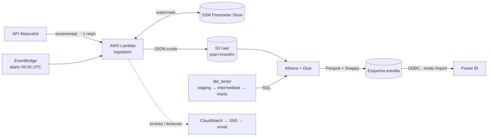

# Oiseaux Nantes — Pipeline Analítico de Biodiversidad

Pipeline de datos end-to-end que ingesta observaciones de **aves (Aves) en el Gran Nantes**
desde la plataforma de ciencia ciudadana [iNaturalist](https://www.inaturalist.org), las
almacena en un Data Lake en **AWS S3**, las transforma con **dbt Core sobre AWS Athena**
mediante una arquitectura medallón (staging → intermedia → marts) y sirve un modelo dimensional
en esquema estrella a **Power BI**.

Es un proyecto de referencia de Data Engineering moderno: EL serverless, analytics engineering
con dbt, calidad de datos con tests automatizados y coste operativo cercano a cero.

## ¿Qué responde?

- ¿Qué especies de aves se observan más en Nantes?
- ¿Cuándo alcanzan su pico las observaciones a lo largo del año (estacionalidad biológica)?
- ¿Dónde se concentran los avistamientos y quiénes son los observadores más activos?
- ¿Qué proporción de observaciones tiene grado de investigación (*research grade*)?

## Arquitectura



La cartografía completa (flujo de ingesta, linaje de dbt, modelo dimensional y CI) está en
[docs/architecture.md](docs/architecture.md).

### Principios de diseño

| Principio | En la práctica |
|-----------|----------------|
| Separación ELT | Lambda solo extrae y carga; dbt transforma; Power BI lee solo `marts` |
| API ética | Ingesta incremental, ~1 petición/s, cabecera `User-Agent` identificable |
| Calidad sin fallos | Tests dbt de unicidad, bounding box y `quality_grade`; un fallo bloquea el merge |
| Mínimo privilegio y coste | IAM sin comodines, Lambda ≤ 3 min, Parquet + Snappy, partition pruning |
| Idempotencia | Deduplicación por `observation_id`; el watermark solo avanza tras una escritura exitosa |

Detalle completo en la [constitución del proyecto](.specify/memory/constitution.md).

## Stack Tecnológico

| Capa | Tecnología |
|------|------------|
| Ingesta | AWS Lambda (Python 3.11+, `requests`, `boto3`) |
| Programación | Amazon EventBridge |
| Estado incremental | AWS SSM Parameter Store |
| Data Lake | AWS S3 (raw JSON / procesado Parquet) |
| Catálogo y cómputo | AWS Glue Data Catalog + AWS Athena |
| Transformación | dbt-core + dbt-athena, `dbt_utils`, `dbt_external_tables` |
| Visualización | Power BI Desktop / Service |
| CI | GitHub Actions |
| Alertas | CloudWatch Alarms + SNS |

## Modelo de Datos

| Capa | Modelo | Materialización | Función |
|------|--------|-----------------|---------|
| Staging | `stg_inaturalist__observations` | view | Casteo, aplanado del JSON, deduplicación |
| Intermedia | `int_observations__geospatial_enriched` | view | Filtro bbox, franja horaria, bandera *research grade* |
| Marts | `fct_observations` | incremental (`insert_overwrite`) | Hechos: una fila por observación |
| Marts | `dim_species` | table | Especie / taxón |
| Marts | `dim_users` | table | Observador |
| Marts | `dim_date` | table | Calendario con estación biológica |

Columnas, tests y contratos en [data-model.md](specs/001-nantes-birds-pipeline/data-model.md)
y [contracts/dbt-models.md](specs/001-nantes-birds-pipeline/contracts/dbt-models.md).

## Estructura del Repositorio

```text
.
├── ingestion/                 # Lambda: cliente iNaturalist, escritor S3, watermark SSM
├── tests/                     # pytest + moto (unit) y test contra la API real (integration)
├── dbt_birds/                 # Proyecto dbt: sources, staging, intermediate, marts, tests
├── .github/workflows/         # CI: dbt compile + dbt test en cada PR
├── reports/                   # Informe de Power BI (.pbix)
├── docs/                      # Arquitectura, infraestructura, Power BI, resultados de validación
└── specs/001-nantes-birds-pipeline/  # Spec, plan, investigación, contratos y tareas
```

## Puesta en Marcha

### Requisitos

- Python 3.11+
- Cuenta de AWS en `eu-west-3` con un bucket S3, las bases de datos de Glue `birds_raw` y
  `birds_dbt` y un workgroup de Athena
- Power BI Desktop con el driver ODBC de Amazon Athena (solo para el informe)

### Tests de la ingesta (sin AWS)

```bash
pip install -r ingestion/requirements.txt -r tests/requirements-dev.txt
PYTHONPATH=ingestion pytest tests/unit/ -v

# Test de integración contra la API real de iNaturalist (solo lectura)
PYTHONPATH=ingestion pytest tests/integration/ -m integration -v
```

### Despliegue de la ingesta

1. Empaquetar `ingestion/` y desplegarlo como la Lambda `birds-inaturalist-ingestion` con la
   variable de entorno `BIRDS_S3_BUCKET`.
2. Configurar el rol IAM, la regla de EventBridge y las alarmas siguiendo
   [docs/infrastructure.md](docs/infrastructure.md).

### Transformaciones dbt

```bash
pip install dbt-athena-community
cd dbt_birds
dbt deps
dbt run-operation stage_external_sources   # una vez, cuando ya existan datos raw
dbt run --full-refresh                     # primera ejecución
dbt test
```

Configurar `s3_staging_dir` y `s3_data_dir` en [dbt_birds/profiles.yml](dbt_birds/profiles.yml).

### Power BI

Seguir [docs/powerbi-setup.md](docs/powerbi-setup.md): conexión ODBC, relaciones del esquema
estrella, los tres visuales (mapa, tendencia estacional, ranking) y las medidas DAX.

## Estado del Proyecto

| Componente | Estado |
|------------|--------|
| Ingesta en Lambda + tests unitarios | ✅ Implementada — 14/14 tests pasan |
| Modelos y tests dbt | ✅ Implementados |
| CI de GitHub Actions | ✅ Configurada |
| Documentación de infraestructura y Power BI | ✅ Completa |
| Informe `reports/nantes_birds.pbix` | ⏳ Pendiente (se crea en Power BI Desktop) |
| Validación end-to-end en AWS real | ⏳ Pendiente — ver [validation-results.md](docs/validation-results.md) |

## Documentación

- [Especificación funcional](specs/001-nantes-birds-pipeline/spec.md)
- [Plan de implementación](specs/001-nantes-birds-pipeline/plan.md)
- [Investigación técnica](specs/001-nantes-birds-pipeline/research.md)
- [Guía de validación (quickstart)](specs/001-nantes-birds-pipeline/quickstart.md)
- [Contrato de la API de iNaturalist](specs/001-nantes-birds-pipeline/contracts/inaturalist-api.md)
- [Lista de tareas](specs/001-nantes-birds-pipeline/tasks.md)

## Datos y Licencia

Los datos de observaciones proceden de la API pública de iNaturalist; cada observación conserva
la licencia elegida por su autor en iNaturalist. El pipeline respeta los límites de uso de la
API e identifica sus peticiones mediante la cabecera `User-Agent`.
