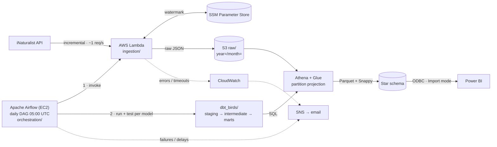

# Oiseaux Nantes — Biodiversity Analytics Pipeline

**English** · [Español](README.es.md) · [Français](README.fr.md)

End-to-end ELT pipeline on AWS that incrementally ingests **bird observations in Greater Nantes
(France)** from the citizen-science platform [iNaturalist](https://www.inaturalist.org), lands
the raw JSON in an **S3 data lake**, transforms it with **dbt on Athena** through a medallion
architecture (raw → staging → marts) into a **Parquet star schema**, and serves it to
**Power BI**. **Apache Airflow** orchestrates ingestion and transformation every day.

It is a reference project for the modern data stack: serverless EL, analytics engineering with
dbt, automated data-quality tests, infrastructure as code and least-privilege security, at a
near-zero running cost.

## Highlights

| | |
|---|---|
| **In production since** | 2026-10-12 · daily run at 05:00 UTC |
| **Data** | 18,454 observations · 583 taxa · 1,874 observers (1970 → today) |
| **Quality** | 77 dbt data tests; a failing test stops every downstream model |
| **Orchestration** | 13-task Airflow DAG (one `run` + `test` pair per dbt model) |
| **Cost** | ~20 USD/month (Airflow EC2); Lambda, S3 and Athena cost cents |

## Questions it answers

- Which bird species are observed most around Nantes?
- When do observations peak during the year (biological seasonality)?
- Where are sightings concentrated, and who are the most active observers?
- What share of observations is *research grade* (identification confirmed by the community)?

## Architecture



Full system map (ingestion flow, Airflow DAG, dbt lineage, dimensional model, CI) in
[docs/architecture.md](docs/architecture.md).

### Design principles

| Principle | In practice |
|-----------|-------------|
| ELT separation | Airflow only orchestrates; Lambda only extracts and loads; dbt transforms; Power BI reads only `marts` |
| Ethical API use | Incremental ingestion with a watermark, ~1 request/s, identifiable `User-Agent` |
| Zero-failure data quality | Uniqueness, bounding-box and `quality_grade` tests; a failing test blocks downstream models |
| Least privilege and cost | No wildcard IAM ARNs (two documented exceptions), private EC2 reached through Session Manager, Parquet + Snappy |
| Idempotency | Deduplication on `observation_id`; the watermark only moves after a successful S3 write |

Project rules live in the [constitution](.specify/memory/constitution.md).

## Tech stack

| Layer | Technology |
|-------|------------|
| Ingestion | AWS Lambda (Python, `requests`, `boto3`) |
| Incremental state | AWS SSM Parameter Store |
| Data lake | AWS S3 (raw JSON, Parquet marts) |
| Catalog and compute | AWS Glue Data Catalog + Amazon Athena (partition projection) |
| Transformation | dbt-core + dbt-athena, `dbt_utils` |
| Orchestration | Apache Airflow 3.3 + Astronomer Cosmos on EC2 (t3.small, LocalExecutor, PostgreSQL) |
| Infrastructure as code | Terraform |
| Alerting | Airflow callbacks + CloudWatch alarms → SNS email |
| CI | GitHub Actions |
| BI | Power BI Desktop (Amazon Athena ODBC 2.x) |

## Data model

| Layer | Model | Materialization | Role |
|-------|-------|-----------------|------|
| Raw | `birds_raw.observations` | external table | iNaturalist JSON as received, partitioned by ingestion year/month |
| Staging | `stg_inaturalist__observations` | view | Casting, JSON flattening, deduplication |
| Intermediate | `int_observations__geospatial_enriched` | view | Bounding-box filter, time of day, research-grade flag |
| Marts | `fct_observations` | table, rebuilt daily, partitioned by year/month | One row per observation |
| Marts | `dim_species` | table | Taxon, with photo, licence, credit and Wikipedia link |
| Marts | `dim_users` | table | Observer |
| Marts | `dim_date` | table | Calendar with biological season |

Data-quality decisions made during deployment: observations without an observation date are
kept in staging (warning test) and excluded from the star schema; dimensions keep the most
recent attributes of each key; the fact table is rebuilt daily so late uploads are never missed.
Columns and tests: [data-model.md](specs/001-nantes-birds-pipeline/data-model.md).

## Repository layout

```text
.
├── ingestion/            # Lambda: iNaturalist client, S3 writer, SSM watermark
├── dbt_birds/            # dbt project: raw table macro, staging, intermediate, marts, tests
├── orchestration/        # Airflow: DAG, alerts, config, bootstrap, deploy script, systemd units
├── infra/airflow/        # Terraform: EC2, IAM role, security group
├── tests/                # pytest: ingestion (unit, integration) and DAG integrity
├── .github/workflows/    # CI: dbt parse and DAG integrity on every PR
├── docs/                 # Architecture, AWS deployment guide, Airflow operations, Power BI, validation
└── specs/                # Spec, plan, research, contracts and tasks per feature (Spec Kit)
```

## Getting started

Step-by-step deployment from scratch (AWS account, Lambda, initial load, Terraform, Airflow,
production cut-over): [docs/despliegue-aws.md](docs/despliegue-aws.md).

Local checks, no AWS needed:

```bash
# Ingestion unit tests
pip install -r ingestion/requirements.txt -r tests/requirements-dev.txt
PYTHONPATH=ingestion pytest tests/unit/ -v

# Airflow DAG integrity (Python 3.12; dbt in its own virtualenv)
pip install -r orchestration/requirements.txt \
  --constraint https://raw.githubusercontent.com/apache/airflow/constraints-3.3.2/constraints-3.12.txt
cd dbt_birds && dbt deps && BIRDS_S3_BUCKET=ci-placeholder \
  dbt parse --profiles-dir ../orchestration/config --target ci && cd ..
pytest tests/orchestration/ -v
```

Power BI connection (read-only IAM user, ODBC driver, star schema, visuals and DAX):
[docs/powerbi-setup.md](docs/powerbi-setup.md).

## Project status

| Component | Status |
|-----------|--------|
| Lambda ingestion + 14 unit tests | ✅ In production |
| dbt models + 77 data tests | ✅ In production |
| Airflow orchestration (Terraform, EC2, DAG, alerts) | ✅ Daily scheduled runs succeeding since 2026-10-13 |
| CI (GitHub Actions) | ✅ dbt parse + 26 DAG tests · ⏳ `dbt test` against Athena (needs OIDC credentials) |
| Power BI report | ✅ Star schema, map, seasonality, rankings, top 3 with species photos · ⏳ `.pbix` not yet in the repo |
| Remaining validation | ⏳ Failure and alert drills, full refresh, IAM simulation, monthly cost review |

Deployment results and the issues fixed along the way: [docs/validation-results.md](docs/validation-results.md).

## Roadmap

- Time-of-day analysis from the actual observation time (`time_observed_at`) instead of upload time
- Refresh observations whose quality grade changes after download
- SCD Type 2 history for `dim_species` with dbt snapshots
- `dbt test` against Athena in CI (GitHub OIDC role) and automatic deployment to the Airflow host on merge
- Separate schemas for staging and marts; French common names (`locale=fr`)

## Documentation

Detailed documentation is written in Spanish.

- Feature 001, pipeline: [spec](specs/001-nantes-birds-pipeline/spec.md) · [plan](specs/001-nantes-birds-pipeline/plan.md) · [data model](specs/001-nantes-birds-pipeline/data-model.md) · [tasks](specs/001-nantes-birds-pipeline/tasks.md)
- Feature 002, Airflow orchestration: [spec](specs/002-airflow-orchestration/spec.md) · [plan](specs/002-airflow-orchestration/plan.md) · [tasks](specs/002-airflow-orchestration/tasks.md)
- [AWS deployment guide](docs/despliegue-aws.md) · [Airflow operations](docs/airflow-operations.md) · [Infrastructure](docs/infrastructure.md) · [Power BI setup](docs/powerbi-setup.md)

## Data and licensing

Observation data comes from the public iNaturalist API; each observation and each species photo
keeps the licence chosen by its author. The photo credit is stored with every species and must
be shown next to the image. The pipeline respects the API usage limits and identifies itself
with a `User-Agent` header.
