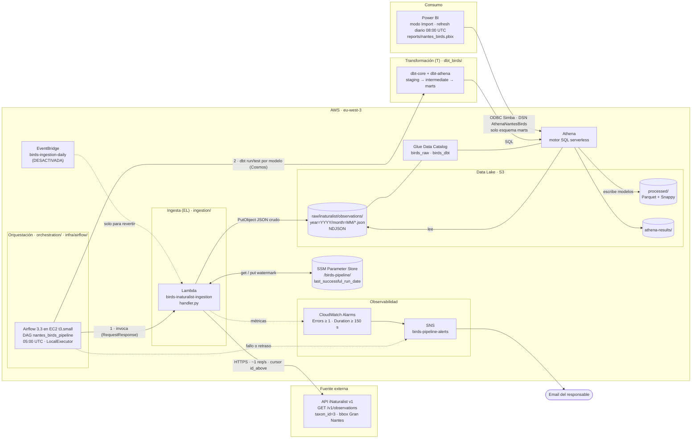
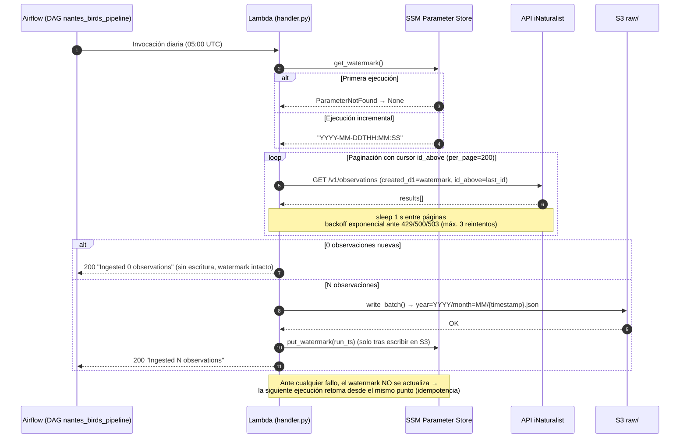
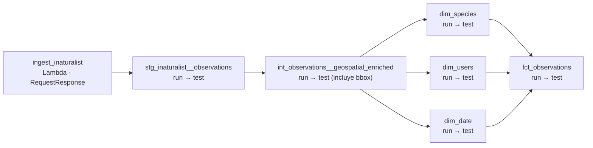
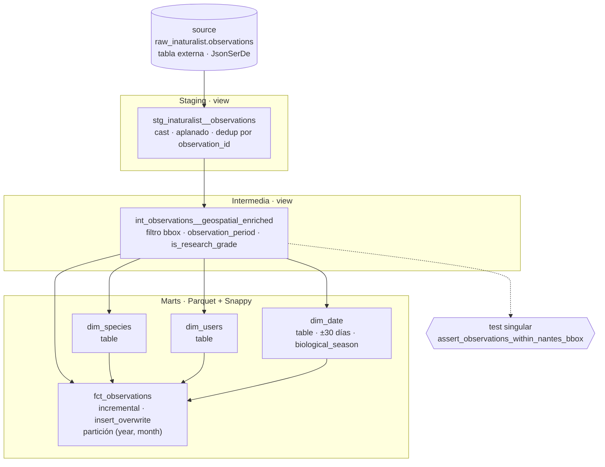
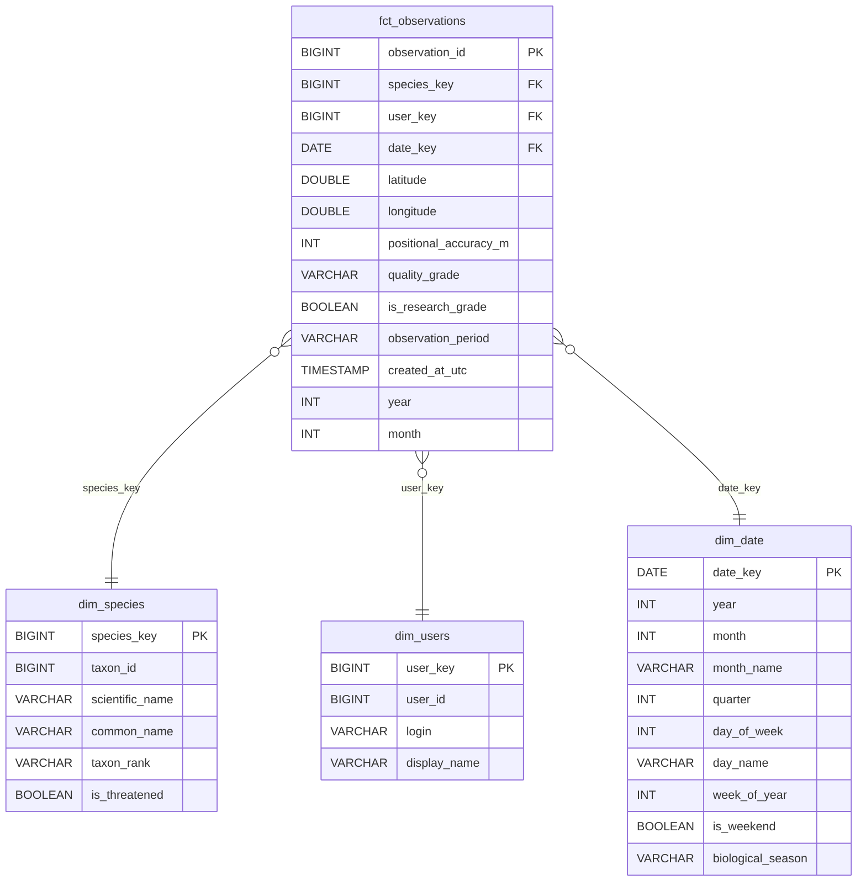
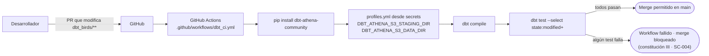

# Cartografía del Sistema — Pipeline de Aves de Nantes

Este documento describe la arquitectura del pipeline con diagramas Mermaid: la vista general de
componentes, el flujo de ingesta, el DAG de orquestación, el linaje de dbt, el modelo
dimensional y la CI.

Desde la feature `002-airflow-orchestration`, Apache Airflow (en una EC2) orquesta la ingesta y
la transformación; la regla de EventBridge queda desactivada.

---

## 1. Vista General de Componentes

**Separación de responsabilidades (constitución I):** Airflow solo orquesta, Lambda solo extrae
y carga (EL), dbt transforma (T) dentro de Athena y Power BI lee únicamente la capa `marts`.

---

## 2. Flujo de Ingesta Incremental

---

## 2b. DAG de Orquestación (`nantes_birds_pipeline`)

- Diario a las 05:00 UTC, una sola ejecución activa, sin ejecuciones atrasadas (`catchup=False`).
- Cada tarea se reintenta 2 veces (5 min). Si falla definitivamente, las dependientes quedan en
  `upstream_failed` y se envía un email por SNS.
- Si la ejecución no ha terminado a las 07:00 UTC, se envía una alerta de retraso.
- Parámetro `full_refresh` (disparo manual): reconstruye los modelos dbt; la ingesta no cambia.
- Contrato completo: [specs/002-airflow-orchestration/contracts/dag-interface.md](../specs/002-airflow-orchestration/contracts/dag-interface.md).

---

## 3. Linaje de dbt (Arquitectura Medallón)

---

## 4. Modelo Dimensional (Esquema Estrella)

---

## 5. CI y Calidad de Datos

---

## Inventario de Componentes

| Componente | Ubicación en el repo | Responsabilidad |
|------------|----------------------|-----------------|
| `handler.py` | `ingestion/` | Orquesta watermark → fetch → write → watermark |
| `inaturalist_client.py` | `ingestion/` | Cliente HTTP paginado, rate limit y reintentos |
| `s3_writer.py` | `ingestion/` | Escribe NDJSON particionado por año/mes |
| `ssm_watermark.py` | `ingestion/` | Lectura/escritura atómica del watermark |
| Tests unitarios / integración | `tests/` | pytest + moto; test real contra la API |
| Proyecto dbt | `dbt_birds/` | Fuentes, modelos medallón, tests |
| DAG de Airflow | `orchestration/dags/` | Encadena ingesta → dbt con reintentos, alertas y `full_refresh` |
| Alertas de Airflow | `orchestration/plugins/alerts.py` | Mensajes de fallo y retraso hacia SNS |
| Despliegue de Airflow | `orchestration/bootstrap/`, `orchestration/deploy/`, `orchestration/systemd/` | Instalación en la EC2, `git pull` + `dbt parse`, servicios |
| Infraestructura de Airflow | `infra/airflow/` | Terraform: EC2, IAM, security group |
| Tests del DAG | `tests/orchestration/` | Integridad del DAG, tarea de ingesta, alertas |
| CI | `.github/workflows/dbt_ci.yml`, `.github/workflows/airflow_ci.yml` | `dbt compile` + `dbt test`; integridad del DAG en cada PR |
| Infraestructura | `docs/infrastructure.md` | EventBridge (desactivada), CloudWatch, SNS, IAM (vía AWS CLI) |
| Operación de Airflow | `docs/airflow-operations.md` | Acceso, despliegue, ejecuciones manuales, recuperación |
| Power BI | `reports/`, `docs/powerbi-setup.md` | Conexión ODBC, relaciones, visuales y medidas DAX |
