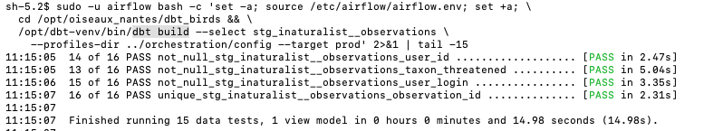
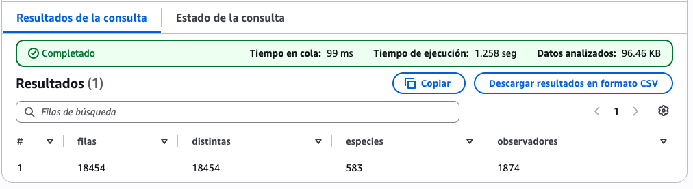
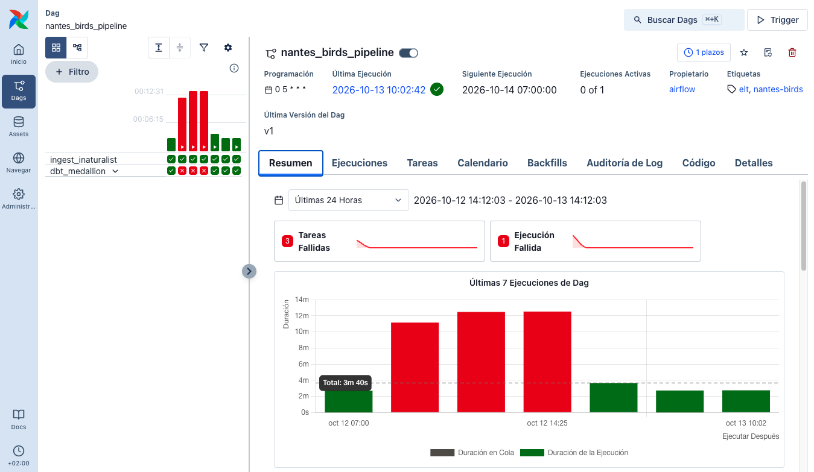
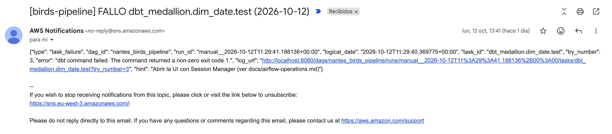

# Resultados de Validación — Pipeline de Aves de Nantes

**Referencia**: `specs/001-nantes-birds-pipeline/quickstart.md`

---

## Resultados de los Tests Unitarios (Sin AWS Real)

Ejecutados con `PYTHONPATH=ingestion pytest tests/unit/ -v`:

| Módulo | Tests | Resultado |
|--------|-------|-----------|
| `test_inaturalist_client.py` | 6 | ✅ PASS |
| `test_s3_writer.py` | 4 | ✅ PASS |
| `test_ssm_watermark.py` | 4 | ✅ PASS |
| **Total** | **14** | **✅ 14/14 PASS** |

---

## Estado de los Escenarios End-to-End (Requieren AWS Real)

| Escenario | Descripción | Estado | Notas |
|-----------|-------------|--------|-------|
| 1 | Ingesta de primera ejecución | ✅ PASS (2026-10-12) | Hecha desde local, no en Lambda (18.515 observaciones superan los 3 min): 1 archivo NDJSON de 1,3 GB en `year=2026/month=10`; watermark `2026-10-12T10:10:53` |
| 2 | Ejecución incremental — sin duplicados | ✅ PASS (2026-10-12) | Primera invocación de la Lambda: `Ingested 0 observations`, sin `FunctionError` |
| 3 | Validación del modelo de staging en dbt | ✅ PASS (2026-10-12) | 14 PASS + 1 WARN (77 observaciones sin `observed_on`, severidad `warn` por decisión de calidad de datos) |
| 4 | Validación del bbox en la capa intermedia | ✅ PASS (2026-10-12) | 20/20 tests, incluido `assert_observations_within_nantes_bbox`; 18.454 filas |
| 5 | Integridad completa del esquema estrella en marts | ✅ PASS (2026-10-12) | `fct_observations` 18.454 filas = 18.454 `observation_id` distintos; 583 taxones; 1.874 observadores; tests `relationships` en verde |
| 6 | Actualización end-to-end en Power BI | ✅ PASS (2026-10-13) | Conexión ODBC con usuario de solo lectura, modelo estrella, visuales, filtro cruzado y actualización con las columnas de fotos |
| 7 | Idempotencia ante fallos | PENDIENTE | Requiere completar los Escenarios 1–2 |

*Escenario 3: `dbt build` de staging tras corregir el formato de fecha.*

*Escenario 5: 18.454 filas = 18.454 `observation_id` distintos, 583 taxones, 1.874 observadores.*

---

## Cómo Ejecutar la Validación End-to-End

Ver `specs/001-nantes-birds-pipeline/quickstart.md` para los comandos paso a paso de cada escenario.

Requisitos previos:
- AWS CLI configurado para `eu-west-3`
- Lambda `birds-inaturalist-ingestion` desplegada con la variable de entorno `BIRDS_S3_BUCKET`
- Bucket S3 con el prefijo `raw/inaturalist/`
- Parámetro SSM `/birds-pipeline/last_successful_run_date` (ausente = primera ejecución)
- Workgroup de Athena + bases de datos de Glue (`birds_raw`, `birds_dbt`) creados
- Proyecto dbt instalado: `pip install dbt-athena-community && cd dbt_birds && dbt deps`
- Para el Escenario 6: Power BI Desktop con el driver ODBC de Amazon Athena

Actualizar la tabla anterior con los resultados (pass/fail) a medida que cada escenario se valide en el entorno real.

---

## Feature 002 — Orquestación con Airflow (despliegue del 2026-10-12)

Despliegue siguiendo `docs/despliegue-aws.md` en la cuenta `437266392155` (`eu-west-3`).

| Tarea / escenario | Descripción | Estado | Notas |
|-------------------|-------------|--------|-------|
| T016 · Escenario 1 | Infraestructura y servicios | ✅ PASS | `terraform apply`: 6 recursos; security group sin reglas de entrada; bootstrap completado; UI accesible por Session Manager |
| T021 · Escenario 2 | Ejecución completa del DAG | ✅ PASS | `airflow dags test`: 13/13 tareas en `success` (run `manual__2026-10-12T12:57:10`); duración ~3 min |
| T022 | Paso a producción | ✅ PASS | Regla `birds-ingestion-daily` en `DISABLED`; DAG `nantes_birds_pipeline` con `is_paused = False` |
| T028 · Escenarios 3 y 7 | Fallos, reintentos y alertas | 🟡 PARCIAL | Validado con fallos reales del 2026-10-12: 3 reintentos, `upstream_failed` en los dependientes, email de alerta recibido y plazos incumplidos registrados. Falta el simulacro controlado del quickstart |
| T031 · Escenario 4 | Reconstrucción completa bajo demanda | PENDIENTE | |
| T037 · Escenarios 5 y 6 | IAM y programador único | PENDIENTE | |
| T039 | Coste mensual ≤ 25 USD | PENDIENTE | Revisar en Cost Explorer tras una semana |
| — | Primera ejecución programada (05:00 UTC) | ✅ PASS (2026-10-13) | `scheduled__2026-10-13T05:00` en `success` sin intervención manual |
| — | Fotos de especies en `dim_species` (PR #7) | ✅ PASS (2026-10-13) | Tabla raw recreada con `recreate: true`; DAG en `success`; Top 3 con `photo_url`, licencia y atribución |

*Las 3 ejecuciones fallidas del 12 de octubre (problemas corregidos en el PR #5) y las siguientes en verde, incluida la primera programada.*

*Alerta real recibida por email durante el despliegue (fallo de `dim_date.test`, intento 3).*

### Problemas encontrados y corregidos durante el despliegue

| Problema | Corrección | PR |
|----------|------------|----|
| `stage_external_sources` no funciona con Athena; las particiones mensuales no se registraban | Macro `create_raw_observations_table` con partition projection | #4 |
| La primera ingesta sin watermark supera el timeout de 3 min de Lambda | Carga histórica inicial desde local (paso 4 del instructivo) | #4 |
| `CAST(created_at AS TIMESTAMP)` falla con ISO 8601 con zona | `from_iso8601_timestamp` normalizado a UTC | #5 |
| 77 observaciones sin `observed_on` | Staging las conserva (test en `warn`); intermedia las excluye | #5 |
| `expression_is_true` a nivel de columna repetía el nombre de la columna | Expresión sin el nombre de la columna | #5 |
| Test singular del bbox declarado como test genérico | Se retira de la YAML (se ejecuta solo) | #5 |
| `dim_date` superaba el límite de 10.000 elementos de `SEQUENCE` (histórico desde 1970) | Secuencia en dos niveles | #5 |
| `fct_observations` incremental borraba el mes en curso y no recogía subidas tardías | Reconstrucción completa diaria | #5 |
| Tests `relationships` ejecutados antes de construir `fct_observations` | Cosmos `test_indirect_selection=BUILDABLE` | #5 |
| Duplicados por `taxon_id` en `dim_species` | Una fila por clave con los atributos más recientes (también en `dim_users`) | #5 |
| Faltaban `glue:GetTableVersions` y `glue:DeleteTableVersion` en el rol de Airflow | Añadidos a `iam.tf` y al contrato IAM | #5 |
| Variables `$VAR:` recortadas por zsh y `ensurepip` roto en Python 3.14.4 | Llaves `${VAR}` y Python 3.13 en el instructivo | #5 |

### Limitaciones conocidas (mejoras futuras)

- `observation_period` se calcula con `created_at` (hora de subida), no con la hora real de observación (`time_observed_at`, no incluida en la tabla raw).
- El watermark filtra por fecha de creación: los cambios posteriores de una observación (p. ej. `quality_grade`) no se vuelven a descargar.
- El JSON raw ocupa ~70 KB por observación (1,3 GB en total) y staging/intermedia son vistas: cada ejecución diaria lee ~5 GB en Athena (< 1 USD/mes).
- La CI de dbt solo ejecuta `dbt parse`; `dbt test` contra Athena requiere un rol OIDC para GitHub Actions.

---

## Retirada de la infraestructura (2026-10-16)

Tras validar el pipeline en producción del 12 al 16 de octubre, se retiró toda la infraestructura
de AWS para no generar costes, siguiendo el paso 11 de `docs/despliegue-aws.md`.

| Recurso | Cómo se retiró | Comprobación |
|---------|----------------|--------------|
| EC2 de Airflow, disco, security group, rol e instance profile | `terraform destroy` (6 recursos) | Instancia `terminated`; sin volúmenes ni security group |
| Regla de EventBridge `birds-ingestion-daily` | `remove-targets` + `delete-rule` | `ResourceNotFoundException` |
| Lambda, grupo de logs, alarmas y rol de la Lambda | AWS CLI | `ResourceNotFoundException` / `[]` / `NoSuchEntity` |
| Topic SNS de alertas y watermark en SSM | AWS CLI | `[]` / `ParameterNotFound` |
| Bases de datos de Glue `birds_raw` y `birds_dbt` | `delete-database` | `[]` |
| Bucket de S3 (raw, processed, resultados de Athena) | `s3 rm --recursive` + `delete-bucket` | `404 Not Found` |
| Usuario IAM `oiseaux-powerbi` y su DSN en Windows | AWS CLI y Administrador ODBC | `NoSuchEntity` |

Comprobación final: ningún recurso con la etiqueta `project = oiseaux-nantes` ni con prefijo
`birds`/`oiseaux` en EC2, Lambda, CloudWatch, SNS, Glue, S3 ni IAM (salvo el usuario
administrador de la cuenta). El código, la documentación y las capturas permiten volver a
desplegarlo con `docs/despliegue-aws.md`.

