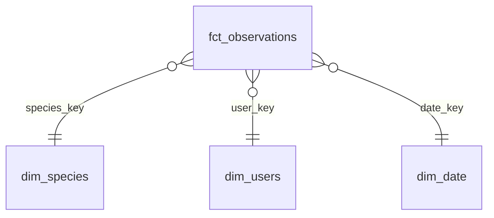

# Modelo de Datos: Pipeline de Biodiversidad de Aves en Nantes

**Feature**: `001-nantes-birds-pipeline` | **Fecha**: 2026-10-10

## Visión General de la Arquitectura

```
S3 (raw JSON, partitioned year/month)
  └── Athena External Table: raw_inaturalist.observations
        │
        ▼
  stg_inaturalist__observations       [Staging — 1:1 raw; cast, flatten, dedup]
        │
        ▼
  int_observations__geospatial_enriched  [Intermediate — spatial filter, time period, flags]
        │
        ├──────────────────────────────────────────┐
        ▼                                          ▼
  fct_observations (FACT)                   dim_species (DIM)
  dim_users (DIM)                           dim_date (DIM)
```

El esquema estrella de la capa `marts/` es consumido por Power BI. Power BI NO DEBE acceder
directamente a las capas de staging ni intermedia.

---

## Fuente Raw

### `raw_inaturalist.observations` (Tabla Externa de Athena)

| Columna | Tipo | Notas |
|---------|------|-------|
| `raw_json` | STRING | Objeto JSON completo de la respuesta por observación, guardado tal cual |
| `year` | STRING | Clave de partición Hive derivada de `created_at` |
| `month` | STRING | Clave de partición Hive derivada de `created_at` |

- **Formato**: Un objeto JSON por línea (NDJSON) en cada archivo de S3
- **Ruta S3**: `s3://{bucket}/raw/inaturalist/observations/year={YYYY}/month={MM}/`
- **SerDe**: `org.openx.data.jsonserde.JsonSerDe`
- **Gestionada por**: Ingesta en Lambda; DDL registrado mediante `dbt-external-tables`
- **Schema drift**: Tolerado en esta capa; los campos nuevos son ignorados por los modelos posteriores

---

## Capa de Staging

### `stg_inaturalist__observations`

**Propósito**: Mapeo 1:1 de la fuente raw. Castea tipos, renombra a snake_case, aplana las
estructuras JSON anidadas y hace una deduplicación preliminar por `observation_id`. Sin lógica
de negocio.

**Materialización**: `view` (sin coste de almacenamiento; siempre refleja los datos raw actuales)

| Columna | Tipo | Origen | Transformación |
|---------|------|--------|----------------|
| `observation_id` | BIGINT | `id` | Cast a BIGINT; PK |
| `created_at_utc` | TIMESTAMP | `created_at` | Parseo ISO 8601; normalizado a UTC |
| `observed_on` | DATE | `observed_on` | Parseo `YYYY-MM-DD` |
| `latitude` | DOUBLE | `location` | Separar la cadena `"lat,lng"` por `,`; índice 0 |
| `longitude` | DOUBLE | `location` | Separar la cadena `"lat,lng"` por `,`; índice 1 |
| `positional_accuracy_m` | INT | `positional_accuracy` | Cast directo; admite nulos |
| `quality_grade` | VARCHAR | `quality_grade` | Directo; validado en tests |
| `taxon_id` | BIGINT | `taxon.id` | Aplanar objeto anidado |
| `taxon_scientific_name` | VARCHAR | `taxon.name` | Aplanar |
| `taxon_common_name` | VARCHAR | `taxon.preferred_common_name` | Aplanar; admite nulos |
| `taxon_rank` | VARCHAR | `taxon.rank` | Aplanar |
| `taxon_threatened` | BOOLEAN | `taxon.threatened` | Aplanar |
| `user_id` | BIGINT | `user.id` | Aplanar objeto anidado |
| `user_login` | VARCHAR | `user.login` | Aplanar |
| `user_display_name` | VARCHAR | `user.name` | Aplanar; admite nulos |
| `_ingested_year` | STRING | partición `year` | Se propaga para el particionado posterior |
| `_ingested_month` | STRING | partición `month` | Se propaga para el particionado posterior |

**Tests dbt**:
- `observation_id`: `unique`, `not_null`
- `quality_grade`: `accepted_values: [research, needs_id, casual]`
- `latitude`: `not_null`
- `longitude`: `not_null`
- `taxon_id`: `not_null`
- `user_id`: `not_null`

**Lógica de deduplicación**: `ROW_NUMBER() OVER (PARTITION BY observation_id ORDER BY created_at_utc DESC) = 1`

---

## Capa Intermedia

### `int_observations__geospatial_enriched`

**Propósito**: Capa de lógica de negocio. Aplica la validación espacial (bounding box del Gran
Nantes), la clasificación por franja horaria y la bandera de grado de investigación. No se
permite que los marts referencien modelos de staging.

**Materialización**: `view`

**Entradas**: `stg_inaturalist__observations`

**Filtro de bounding box** (FR-005):
```
swlat = 46.8600781, swlng = -2.6257395
nelat = 47.8359431, nelng = -0.9466615
```
Los registros fuera de esta caja se excluyen (descarte silencioso — no es un error según los
supuestos de la spec). Los registros **exactamente en el límite** se incluyen (comparación `>=`/`<=`).

| Columna | Tipo | Origen | Transformación |
|---------|------|--------|----------------|
| `observation_id` | BIGINT | staging | Se propaga |
| `created_at_utc` | TIMESTAMP | staging | Se propaga |
| `observed_on` | DATE | staging | Se propaga |
| `latitude` | DOUBLE | staging | Se propaga (ya validada en el filtro bbox) |
| `longitude` | DOUBLE | staging | Se propaga |
| `positional_accuracy_m` | INT | staging | Se propaga |
| `quality_grade` | VARCHAR | staging | Se propaga |
| `is_research_grade` | BOOLEAN | `quality_grade` | `quality_grade = 'research'` (FR-007) |
| `observation_period` | VARCHAR | `created_at_utc` | Clasificación por hora (FR-006) |
| `taxon_id` | BIGINT | staging | Se propaga |
| `taxon_scientific_name` | VARCHAR | staging | Se propaga |
| `taxon_common_name` | VARCHAR | staging | Se propaga |
| `taxon_rank` | VARCHAR | staging | Se propaga |
| `taxon_threatened` | BOOLEAN | staging | Se propaga |
| `user_id` | BIGINT | staging | Se propaga |
| `user_login` | VARCHAR | staging | Se propaga |
| `user_display_name` | VARCHAR | staging | Se propaga |
| `observed_year` | INT | `observed_on` | `YEAR(observed_on)` — para particionar la tabla de hechos |
| `observed_month` | INT | `observed_on` | `MONTH(observed_on)` — para particionar la tabla de hechos |

**Clasificación de `observation_period`** (FR-006):
| Hora (local de París, convertida desde UTC) | Período |
|---------------------------------------------|---------|
| 00:00 – 05:59 | Madrugada |
| 06:00 – 11:59 | Mañana |
| 12:00 – 17:59 | Tarde |
| 18:00 – 23:59 | Noche |

Nota: la clasificación se basa en la hora local (hora de París = UTC+1/+2) — convertir
`created_at_utc` a `Europe/Paris` antes de asignar la franja.

**Tests dbt**:
- `observation_id`: `unique`, `not_null`
- `is_research_grade`: `not_null`
- `observation_period`: `accepted_values: [Madrugada, Mañana, Tarde, Noche]`
- Test singular personalizado: `assert_observations_within_nantes_bbox.sql`

---

## Capa de Marts (Esquema Estrella)

### `fct_observations` (Tabla de Hechos)

**Propósito**: Tabla de hechos central para las consultas analíticas de Power BI. Una fila por
observación de ave válida dentro del Gran Nantes.

**Materialización**: `table`, reconstruida en cada ejecución (Parquet + Snappy, particionada por `(year, month)`)

> **Cambio (2026-10-12):** `fct_observations` pasa a reconstruirse completa en cada ejecución. La versión incremental (`insert_overwrite` + `observed_on > MAX(date_key)`) borraba las filas anteriores del mes en curso, porque `insert_overwrite` reemplaza particiones completas, y nunca recogía las observaciones subidas con retraso.

**Granularidad**: Una fila por `observation_id`

| Columna | Tipo | FK | Notas |
|---------|------|----|-------|
| `observation_id` | BIGINT | — | PK; clave sustituta |
| `species_key` | BIGINT | `dim_species.species_key` | FK |
| `user_key` | BIGINT | `dim_users.user_key` | FK |
| `date_key` | DATE | `dim_date.date_key` | FK |
| `latitude` | DOUBLE | — | WGS84 |
| `longitude` | DOUBLE | — | WGS84 |
| `positional_accuracy_m` | INT | — | Admite nulos |
| `quality_grade` | VARCHAR | — | `research`/`needs_id`/`casual` |
| `is_research_grade` | BOOLEAN | — | FR-007 |
| `observation_period` | VARCHAR | — | FR-006 |
| `created_at_utc` | TIMESTAMP | — | Momento original de envío |
| `year` | INT | — | Clave de partición |
| `month` | INT | — | Clave de partición |

**Filtro incremental**: ninguno (reconstrucción completa; ver la nota de la materialización)

**Tests dbt**:
- `observation_id`: `unique`, `not_null`
- `species_key`: `not_null`, `relationships` → `dim_species.species_key`
- `user_key`: `not_null`, `relationships` → `dim_users.user_key`
- `date_key`: `not_null`, `relationships` → `dim_date.date_key`
- `quality_grade`: `accepted_values`
- `is_research_grade`: `not_null`

---

### `dim_species` (Dimensión de Especie / Taxón)

**Propósito**: Una fila por cada taxón único observado. Dimensión lentamente cambiante (SCD
Tipo 1 — se sobrescribe en cada re-ejecución).

**Materialización**: `table`

**Granularidad**: Una fila por `taxon_id`

| Columna | Tipo | Notas |
|---------|------|-------|
| `species_key` | BIGINT | PK; sustituta = `taxon_id` |
| `taxon_id` | BIGINT | ID de taxón de iNaturalist |
| `scientific_name` | VARCHAR | Binomio latino |
| `common_name` | VARCHAR | Admite nulos (ausente en taxones poco comunes) |
| `taxon_rank` | VARCHAR | p. ej., `species`, `subspecies`, `genus` |
| `is_threatened` | BOOLEAN | Bandera de amenaza de iNaturalist |

**Tests dbt**:
- `species_key`: `unique`, `not_null`
- `taxon_id`: `unique`, `not_null`
- `scientific_name`: `not_null`

---

### `dim_users` (Dimensión de Observador / Usuario)

**Propósito**: Una fila por cada observador (científico ciudadano) único. SCD Tipo 1.

**Materialización**: `table`

**Granularidad**: Una fila por `user_id`

| Columna | Tipo | Notas |
|---------|------|-------|
| `user_key` | BIGINT | PK; sustituta = `user_id` |
| `user_id` | BIGINT | ID de usuario de iNaturalist |
| `login` | VARCHAR | Nombre de usuario de iNaturalist |
| `display_name` | VARCHAR | Nombre completo visible; admite nulos |

**Tests dbt**:
- `user_key`: `unique`, `not_null`
- `user_id`: `unique`, `not_null`
- `login`: `not_null`

---

### `dim_date` (Dimensión de Calendario)

**Propósito**: Serie de calendario continua que cubre el rango completo de fechas de
observación, enriquecida con la estacionalidad biológica. Generada por dbt (sin dependencia de
una fuente).

**Materialización**: `table`

**Granularidad**: Una fila por día de calendario

**Rango de fechas**: Derivado de `MIN(observed_on)` a `MAX(observed_on)` en
`int_observations__geospatial_enriched`, ampliado ±30 días como margen (FR-011).

| Columna | Tipo | Notas |
|---------|------|-------|
| `date_key` | DATE | PK |
| `year` | INT | Año natural |
| `month` | INT | Número de mes (1–12) |
| `month_name` | VARCHAR | p. ej., `January` |
| `quarter` | INT | 1–4 |
| `day_of_week` | INT | 1 (lun) – 7 (dom) ISO |
| `day_name` | VARCHAR | p. ej., `Monday` |
| `week_of_year` | INT | Número de semana ISO |
| `is_weekend` | BOOLEAN | `day_of_week IN (6, 7)` |
| `biological_season` | VARCHAR | FR-011; ver tabla siguiente |

**Correspondencia de estaciones biológicas** (hemisferio norte, latitud del Gran Nantes):
| Mes | Estación |
|-----|----------|
| Marzo, abril, mayo | Primavera |
| Junio, julio, agosto | Verano |
| Septiembre, octubre, noviembre | Otoño |
| Diciembre, enero, febrero | Invierno |

**Caso límite**: Observaciones con `observed_on` anterior a `MIN(dim_date.date_key)` — no es
posible si el rango de fechas se genera después de poblar staging. Si un backfill introduce
fechas anteriores, `dim_date` debe regenerarse con `--full-refresh`.

**Tests dbt**:
- `date_key`: `unique`, `not_null`
- `biological_season`: `accepted_values: [Primavera, Verano, Otoño, Invierno]`

---

## Diagrama Entidad-Relación



---

## Resumen de Reglas de Validación

| Regla | Aplicada por | ¿Bloquea la promoción? |
|-------|--------------|------------------------|
| `observation_id` único + no nulo | dbt `unique` + `not_null` | Sí (SC-004) |
| Todas las coordenadas dentro del bbox de Nantes | Test SQL singular personalizado | Sí |
| `quality_grade` ∈ {research, needs_id, casual} | `accepted_values` | Sí |
| Integridad de FK (fct → todas las dims) | test `relationships` | Sí |
| `dim_date` cubre todos los `observed_on` | `relationships` sobre `date_key` | Sí |
| `observation_period` ∈ 4 valores válidos | `accepted_values` | Sí |
