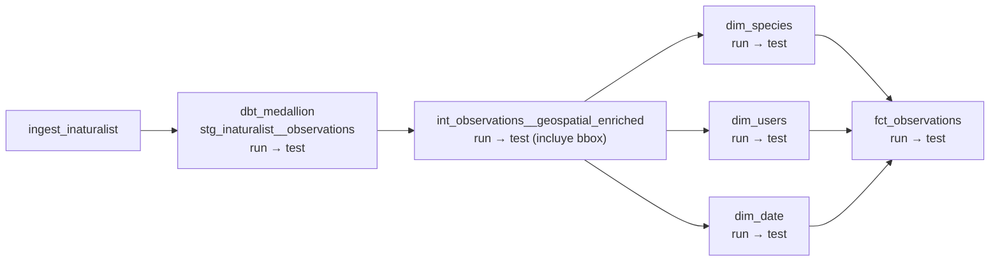

# Contrato: Interfaz del DAG `nantes_birds_pipeline`

**Consumidores**: ingeniero de datos (UI y CLI de Airflow), test de integridad
(`tests/orchestration/test_dag_integrity.py`), documentación de operaciones
**Fecha**: 2026-10-11

Este contrato define lo que el DAG garantiza hacia fuera: identificador, programación,
parámetros, tareas y dependencias. El test de integridad debe comprobar cada punto marcado con ✔.

---

## Identificación y programación

| Campo | Valor garantizado | ✔ en test |
|-------|-------------------|-----------|
| `dag_id` | `nantes_birds_pipeline` | ✔ |
| `schedule` | `0 5 * * *` en UTC | ✔ |
| `catchup` | `False` | ✔ |
| `max_active_runs` | `1` | ✔ |
| `default_args.retries` | `2` | ✔ |
| `default_args.retry_delay` | `timedelta(minutes=5)` | ✔ |
| `default_args.on_failure_callback` | definido | ✔ |

## Parámetros de disparo manual

| Parámetro | Tipo | Por defecto | Efecto |
|-----------|------|-------------|--------|
| `full_refresh` | boolean | `false` | Si es `true`, todas las tareas `run` de dbt usan `--full-refresh`. La ingesta no cambia. |

Disparo desde la CLI:

```bash
airflow dags trigger nantes_birds_pipeline --conf '{"full_refresh": true}'
```

Cualquier otro parámetro se ignora. Un valor que no sea booleano debe rechazarse al disparar
(validación de `Param` con `type="boolean"`).

## Tareas y dependencias



| Garantía | ✔ en test |
|----------|-----------|
| Existe la tarea `ingest_inaturalist` y no tiene dependencias previas | ✔ |
| Existe el grupo de tareas `dbt_medallion` con las 6 parejas `run`/`test` de los modelos de la feature 001 | ✔ |
| Toda tarea de `dbt_medallion` depende (directa o indirectamente) de `ingest_inaturalist` | ✔ |
| La tarea `run` de cada modelo depende de la tarea `test` de sus modelos padre | ✔ |
| No hay tareas fuera de `ingest_inaturalist` y `dbt_medallion` (Power BI queda fuera, FR-016) | ✔ |

## Tarea `ingest_inaturalist`

| Campo | Valor |
|-------|-------|
| Operador | `LambdaInvokeFunctionOperator` |
| `function_name` | `birds-inaturalist-ingestion` |
| `invocation_type` | `RequestResponse` |
| `payload` | `{}` (la Lambda ignora el evento) |
| Éxito | Respuesta sin `FunctionError`; el payload (`{"statusCode": 200, "body": "Ingested N observations"}`) se guarda en XCom |
| Fallo | Respuesta con `FunctionError`, timeout o error de permisos → la tarea falla y se reintenta |

## Compatibilidad

- Cambiar `dag_id`, el nombre de `full_refresh` o el nombre de `ingest_inaturalist` es un cambio
  incompatible: rompe el historial y los procedimientos de `docs/airflow-operations.md`, y
  requiere actualizar este contrato en el mismo PR.
- Añadir modelos dbt nuevos no cambia el contrato: Cosmos los añade automáticamente al grupo.
