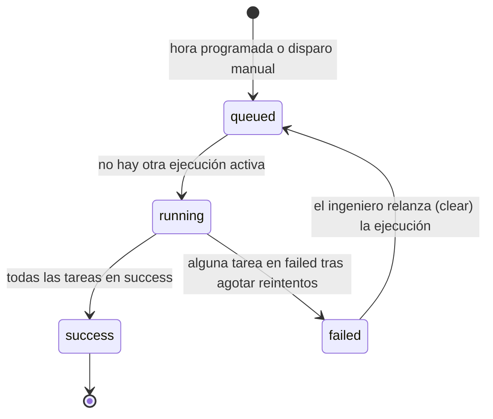

# Modelo de Datos: Orquestación del Pipeline con Apache Airflow

**Feature**: `002-airflow-orchestration` | **Fecha**: 2026-10-11

Este feature no crea tablas analíticas nuevas ni modifica el modelo dimensional de la feature
001. Las entidades de aquí son de **configuración y ejecución** del orquestador; sus datos
viven en la base de metadatos de Airflow (PostgreSQL local), salvo la definición del DAG, que se
versiona en el repositorio.

---

## Entidades

### Flujo diario (DAG) — `nantes_birds_pipeline`

Definición versionada en `orchestration/dags/nantes_birds_pipeline.py`.

| Atributo | Valor | Requisito |
|----------|-------|-----------|
| `dag_id` | `nantes_birds_pipeline` | — |
| `schedule` | `0 5 * * *` (cron, UTC) | FR-001 |
| `start_date` | Fecha fija anterior al despliegue, en UTC | — |
| `catchup` | `False` | FR-011 |
| `max_active_runs` | `1` | FR-010 |
| `default_args.retries` | `2` | FR-007 |
| `default_args.retry_delay` | `5 min` | FR-007 |
| `default_args.on_failure_callback` | `alerts.notify_failure` | FR-008 |
| `params.full_refresh` | `bool`, por defecto `False` | FR-009 |
| `deadline` | Alerta si la ejecución no termina a las 07:00 UTC | SC-001, caso límite |
| `tags` | `["nantes-birds", "elt"]` | — |

**Reglas de validación**:
- El DAG debe cargarse sin errores de importación (FR-018).
- `params.full_refresh` solo se propaga a las tareas dbt, nunca a la tarea de ingesta.
- No puede existir otra fuente de programación activa para la ingesta (FR-012).

---

### Ejecución (DagRun)

Gestionada por Airflow en la base de metadatos.

| Atributo | Descripción |
|----------|-------------|
| `run_id` | `scheduled__<fecha>` o `manual__<fecha>` |
| `run_type` | `scheduled` \| `manual` |
| `logical_date` | Fecha lógica de la ejecución (UTC) |
| `conf` / `params` | `{"full_refresh": false}` por defecto |
| `state` | Ver transiciones |
| `start_date`, `end_date` | Para medir SC-001 y la duración |

**Transiciones de estado**:

---

### Etapa / Tarea (TaskInstance)

| Tarea | Tipo | Depende de | Notas |
|-------|------|------------|-------|
| `ingest_inaturalist` | `LambdaInvokeFunctionOperator` | — | Invoca `birds-inaturalist-ingestion`; falla ante `FunctionError` (FR-003) |
| `dbt_medallion.stg_inaturalist__observations.run` | Cosmos | `ingest_inaturalist` | |
| `dbt_medallion.stg_inaturalist__observations.test` | Cosmos | `…stg….run` | |
| `dbt_medallion.int_observations__geospatial_enriched.run` / `.test` | Cosmos | test de staging | Incluye el test singular del bbox |
| `dbt_medallion.dim_species.run` / `.test` | Cosmos | test de intermedia | |
| `dbt_medallion.dim_users.run` / `.test` | Cosmos | test de intermedia | |
| `dbt_medallion.dim_date.run` / `.test` | Cosmos | test de intermedia | |
| `dbt_medallion.fct_observations.run` / `.test` | Cosmos | tests de intermedia y de las 3 dimensiones | Recibe `full_refresh` |

Los nombres exactos de las tareas Cosmos dependen de la versión; el contrato
([contracts/dag-interface.md](contracts/dag-interface.md)) fija el grupo y el orden, no el
sufijo exacto.

**Transiciones de estado** (por intento): `scheduled → queued → running → success`, o
`running → up_for_retry → (tras 5 min) queued → …`, hasta `failed` tras el tercer intento.
Si una tarea falla, sus dependientes pasan a `upstream_failed` y no se ejecutan (FR-006).

---

### Alerta

Mensaje publicado en el topic SNS `birds-pipeline-alerts`. Estructura en
[contracts/alert-message.md](contracts/alert-message.md).

| Atributo | Descripción |
|----------|-------------|
| `type` | `task_failure` \| `deadline_missed` |
| `dag_id`, `run_id`, `logical_date` | Identificación de la ejecución |
| `task_id`, `try_number` | Tarea fallida e intento (solo `task_failure`) |
| `error` | Mensaje de la excepción, truncado a 1.000 caracteres |
| `log_url` | Enlace a los logs en la UI (accesible por Session Manager) |

---

### Configuración del entorno

| Elemento | Dónde | Valor / origen |
|----------|-------|----------------|
| Conexión `aws_default` | Airflow | Sin credenciales; usa el instance profile; `region_name=eu-west-3` |
| Variable de entorno `BIRDS_S3_BUCKET` | Unidades systemd | Nombre del bucket (lo usa `profiles.yml` de dbt) |
| Variable de entorno `BIRDS_ALERTS_TOPIC_ARN` | Unidades systemd | ARN de `birds-pipeline-alerts` |
| Perfil dbt | `orchestration/config/profiles.yml` | Target `prod` (esquema `birds_dbt`) y target `ci` con valores ficticios, solo para `dbt parse` sin conexión |
| Manifest dbt | `dbt_birds/target/manifest.json` | Generado por `deploy.sh` (`dbt parse`) |

Ningún secreto se guarda en el repositorio ni en variables de Airflow.
